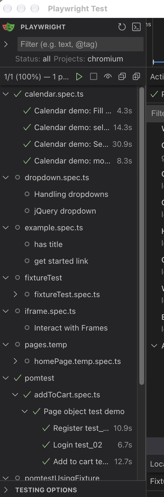
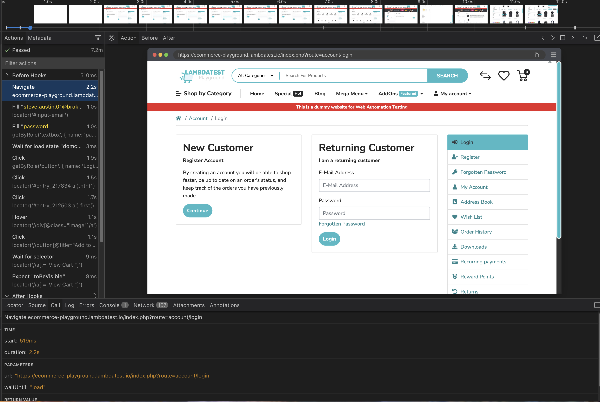
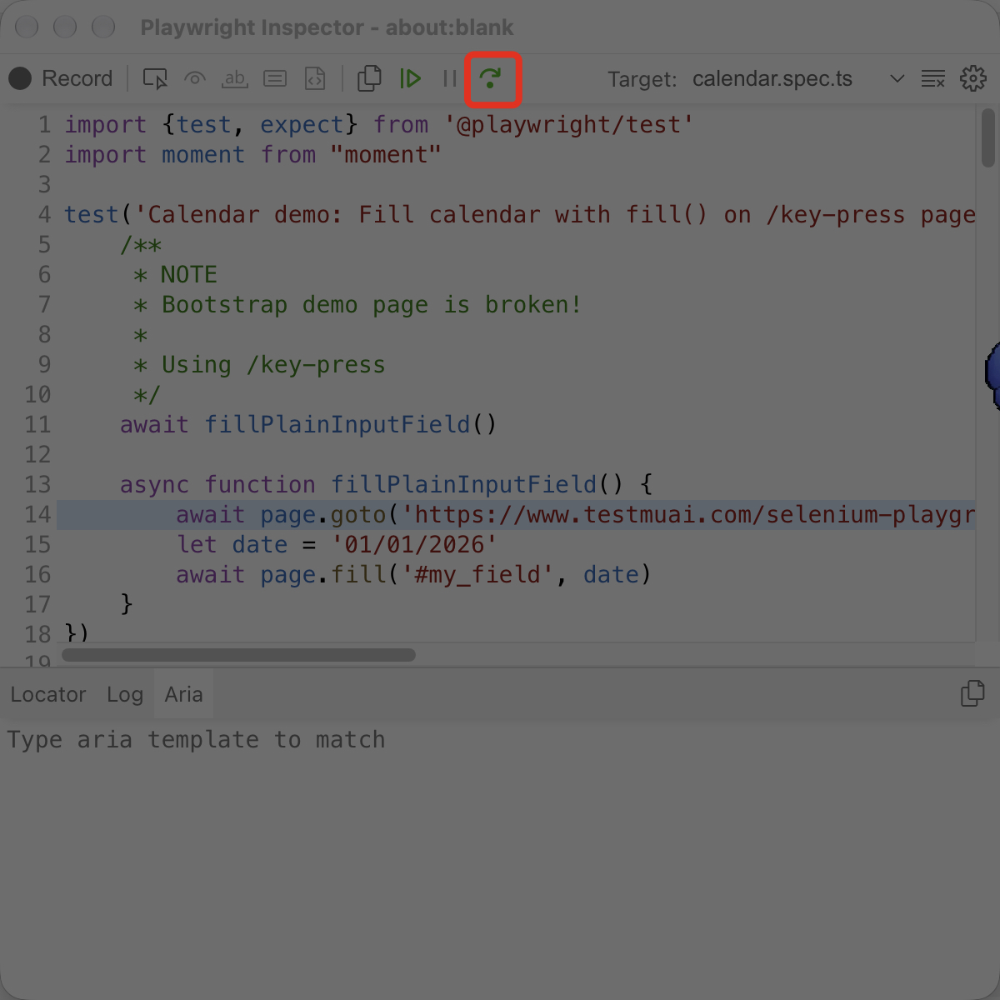
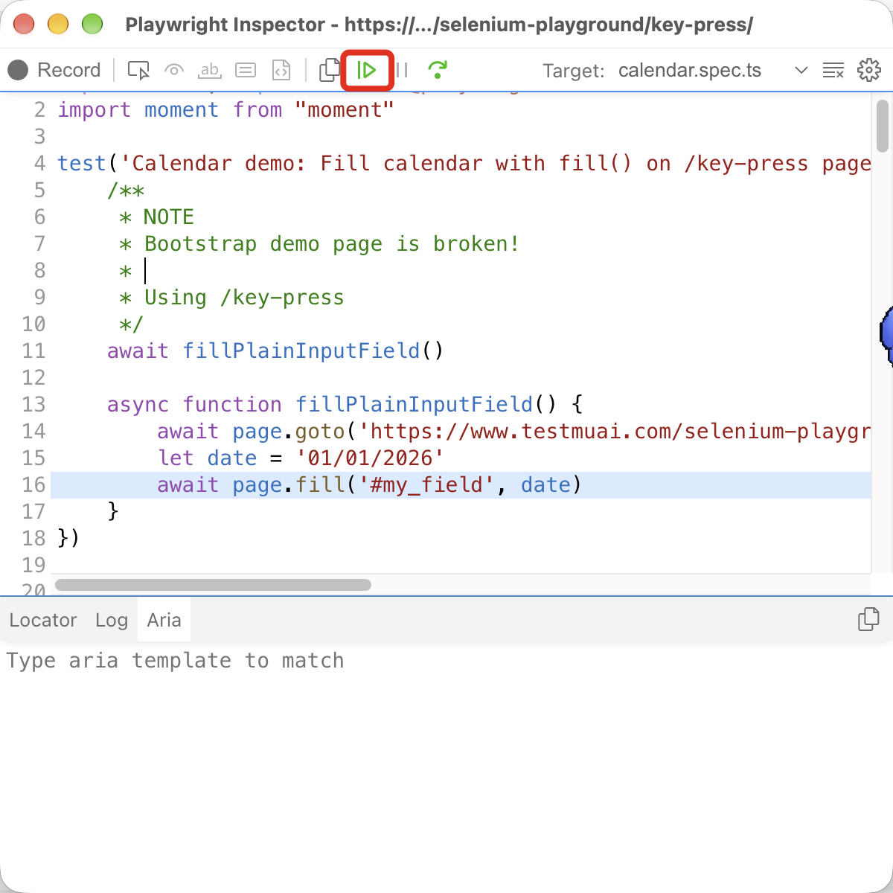
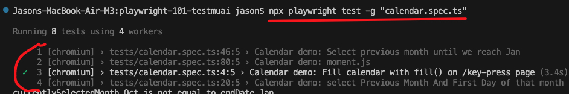
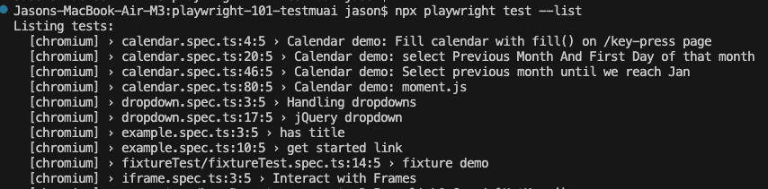
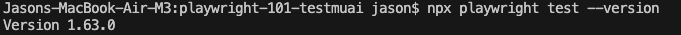
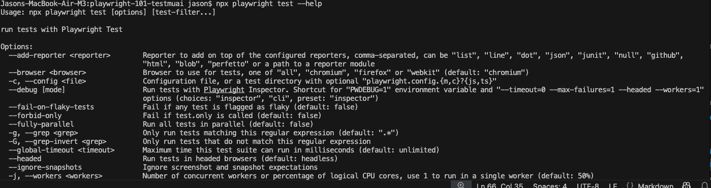

# 1. Essential Playwright commands

## Run all tests (headless and head modes)
```
npx playwright test
```

Runs all tests. From experience, this will run all tests in the folder specified in `playwright.config.ts` eg:
```
testDir: './tests'
```

Should run in headed mode but if it dosnt run:
```
npx playwright test --headed
```

## Run test/s using the UI test runner
```
npx playwright test --ui
```

This opens up the Playwright Test runner window where you can pick tests from a test sidebar panel:



and see the test being ran:


## Run all tests in debug mode (step through failures)
```
npx playwright test --debug
```

This runs every test as per `npx playwright test` but displays the debugger window allowing you to step through code statements in the test script.

You can step through line by line:


And resume execution of the script:


## Run a specific test file (runs all test() blocks within the test file)
```
npx playwright test -g "calendar.spec.ts"
```

This command will run the "calendar.spec.ts" test file and all the test blocs within it.

In this example, it runs all 4 test() blocks in calendar.spec.ts:


## List all tests (available to configured browsers)
```
npx playwright test --list
```


Simply lists all test files (presumably looking at spec.ts files but maybe find by some other means)

## Displays the version of Playwright installed/being used in current project
```
npx playwright --version
```



## Show all terminal commands
```
npx playwright --help
```


