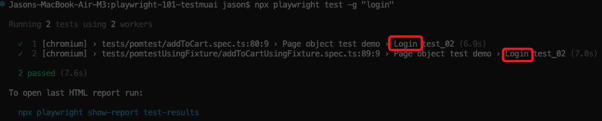
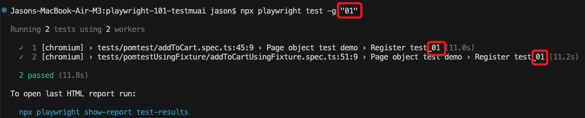
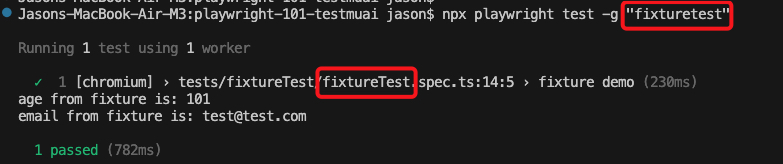
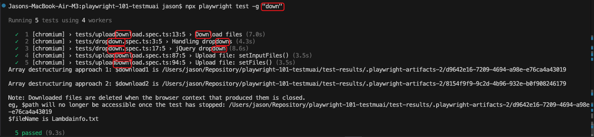
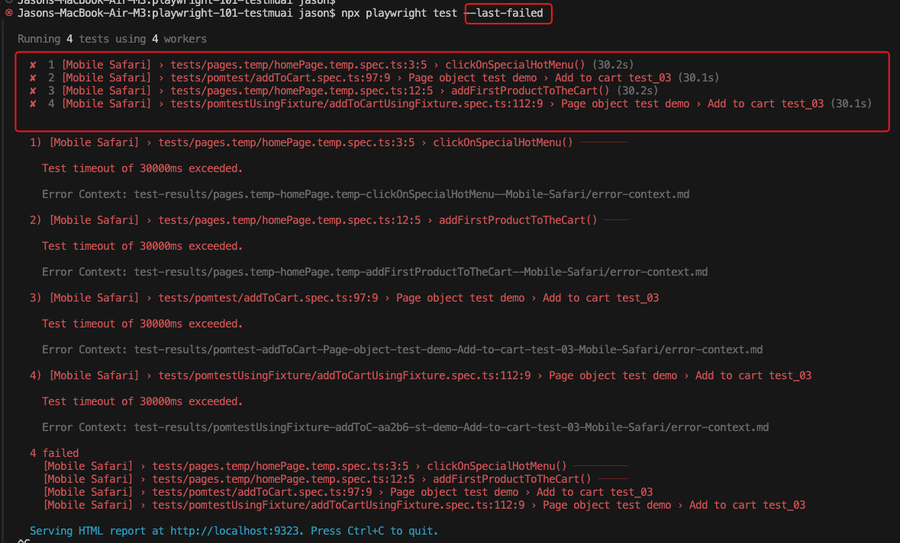

# 2. Run specific tests

## Run a test file (eg, *.spec.ts)
```
npx playwright test tests/pomtest/addToCart.spec.ts
```

Here we point to `tests/pomtest/addToCart.spec.ts` which is the relative path from the playwright root folder.

Note: this runs all test() blocks in parallel.

## Run tests whose titles match parameter (eg, "login", "add to cart", "01", "fixturetest")
```
npx playwright test -g "login"
```

Finds all tests that have "login" in the file name or test() block.



```
npx playwright test -g "01"
```

Finds all tests that have "01" in the file name or test() block.




```
npx playwright test -g "fixturetest"
```

Finds all tests that have "fixturetest" in the file name or test() block.



```
npx playwright test -g "down"
```

Finds all tests that have "down" in the file name or test() block.



Note: this runs all test() blocks in parallel.

## Runs tests against a specific web browser (can include mobile and desktop)
```
npx playwright test --project=webkit
```

Note: You need to have an entry in your playwright.config.ts in order to run this command
```
{
    name: 'webkit',
    use: { ...devices['Desktop Safari'] },
},
```

Note: See projects[] array in playwright.config.ts

## Rerun tests that failed in the previous run
```
npx playwright test --last-failed
```

In the below example, 4 tests failed when running in mobile safari:




