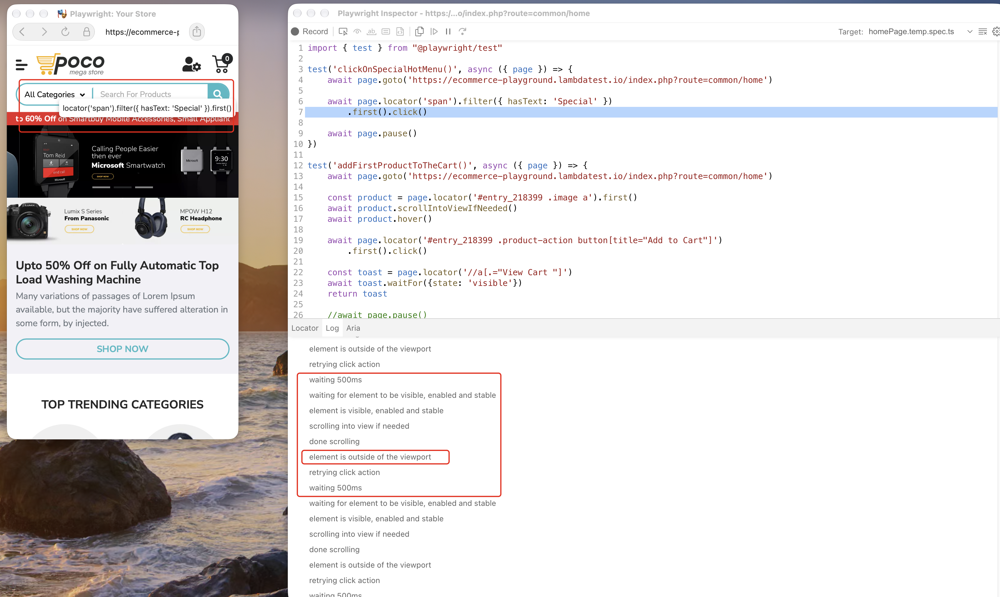
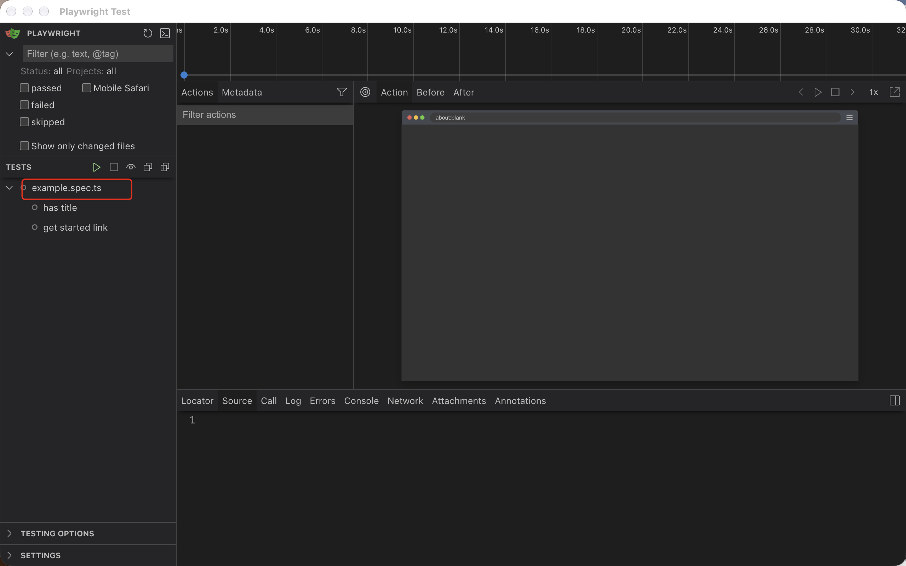
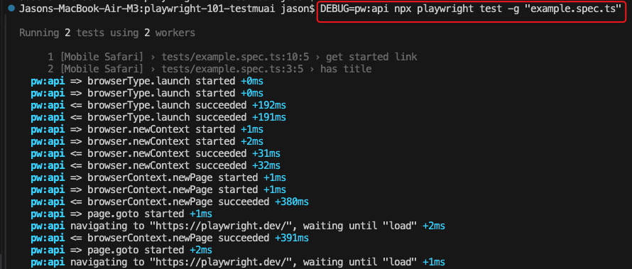
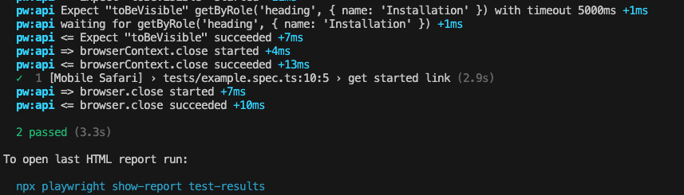
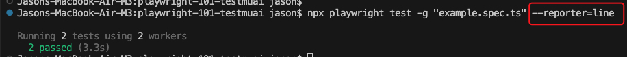
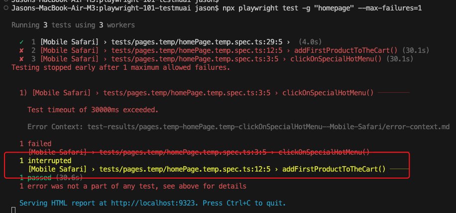

# 3. Debugging commands

## Open the Playwright Inspector (Step through your test, inspect locators and examine browser state.)
```
npx playwright test -g "clickOnSpecialHotMenu" --debug
```
Runs a test() block called "clickOnSpecialHotMenu" and displays the debugger.
Notice the red annotations specifically "element is outside of the viewport". 
This indicates the test cannot click the link as its not displayed in the mobile viewport.
This is an example of affectively using the debugger, analysing the log to see why the test is failing.


## Run a single test file in the interactive test runner / UI mode
```
npx playwright test -g "example.spec.ts" --ui
```
This finds the "example.spec.ts" test file, then opens it up all by itself


## Run test/s with verbose Playwright API logs enabled
```
DEBUG=pw:api npx playwright test -g "example.spec.ts"
```
The above displays all playwright API activity thats happening when running test/s





## Run a test with minimal terminal output
```
npx playwright test -g "example.spec.ts" --reporter=line
```
Runs the test with run and pass/fail status only:


## 
```
npx playwright test --max-failures=1
```
Stops test execution when the 1st failure or N failures have ocurred:
