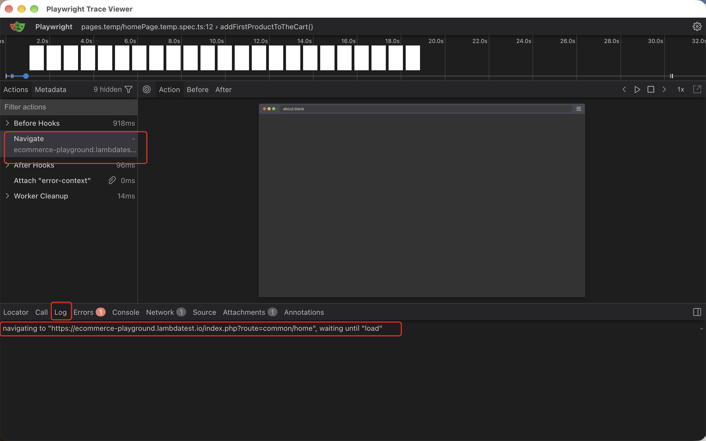
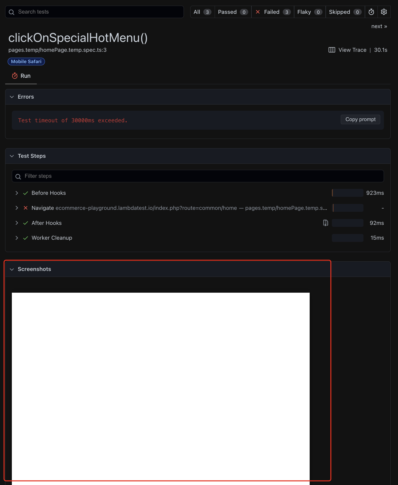

# 4. Screenshots, traces and reports

## Record a trace for each test
```
npx playwright test --trace on
```
Records to `test-results` folder during test execution

To view the trace result run (change 'pages.temp-homePage.temp-addFirstProductToTheCart--Mobile-Safari/trace.zip' to the name of the test):
```
npx playwright show-trace "test-results/pages.temp-homePage.temp-addFirstProductToTheCart--Mobile-Safari/trace.zip"
```
The trace window opens up and looks like the below. Notice the Filter Actions section the exact step where the error happend is highlighted, and the Log details the issue. In this instance, the site was down:


### Playwright config version
```
use: {
  trace: 'on',
},
```

## Screenshot after every test run
```
use: {
    screenshot: 'on',
},
```
This saves a screenshot of the app under test and displays it in the html report:


Note:
ONLY supported in playwright.config.ts.

--screenshot is not a supported command-line option for npx playwright test / providiing a specific file name such as 'npx playwright test -g "homepage" --screenshot only-on-failure'

